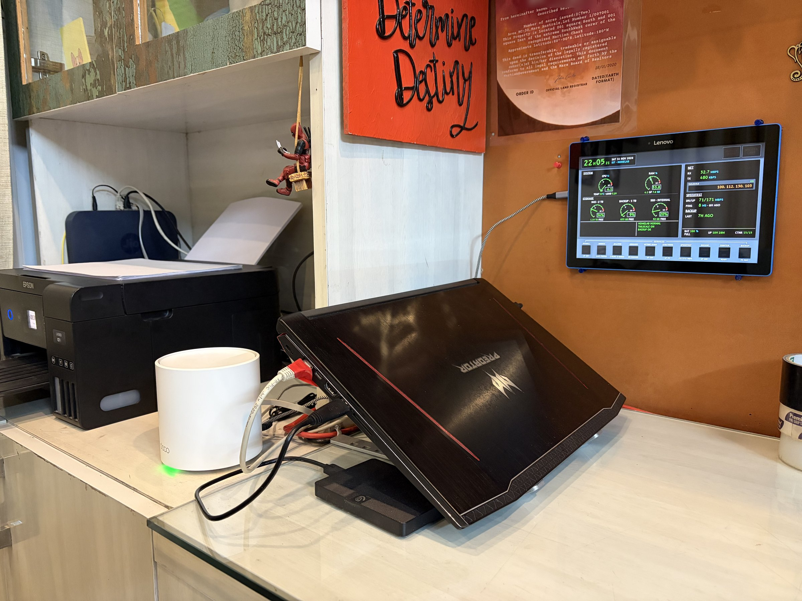
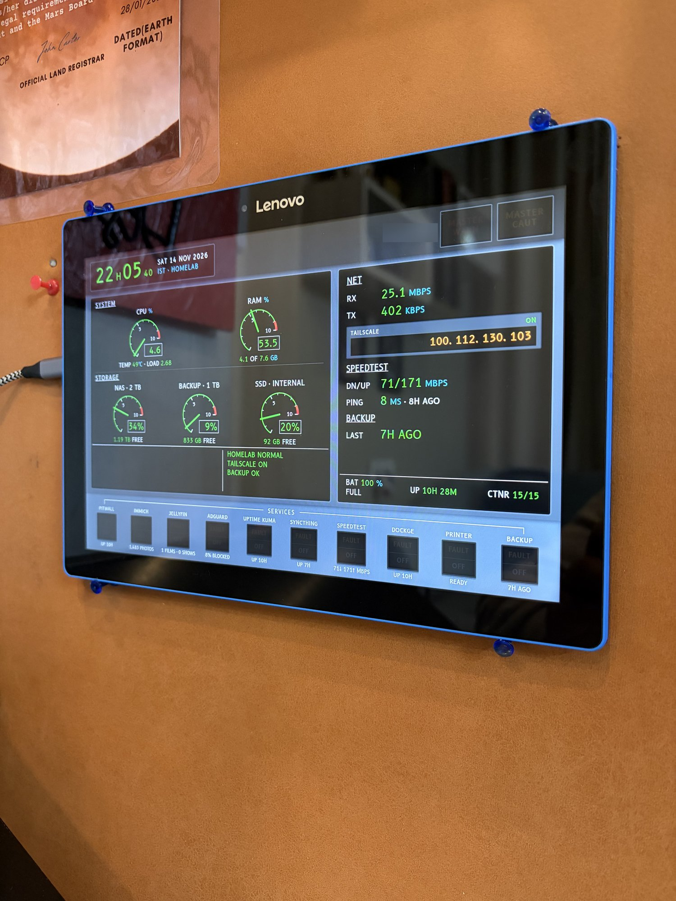
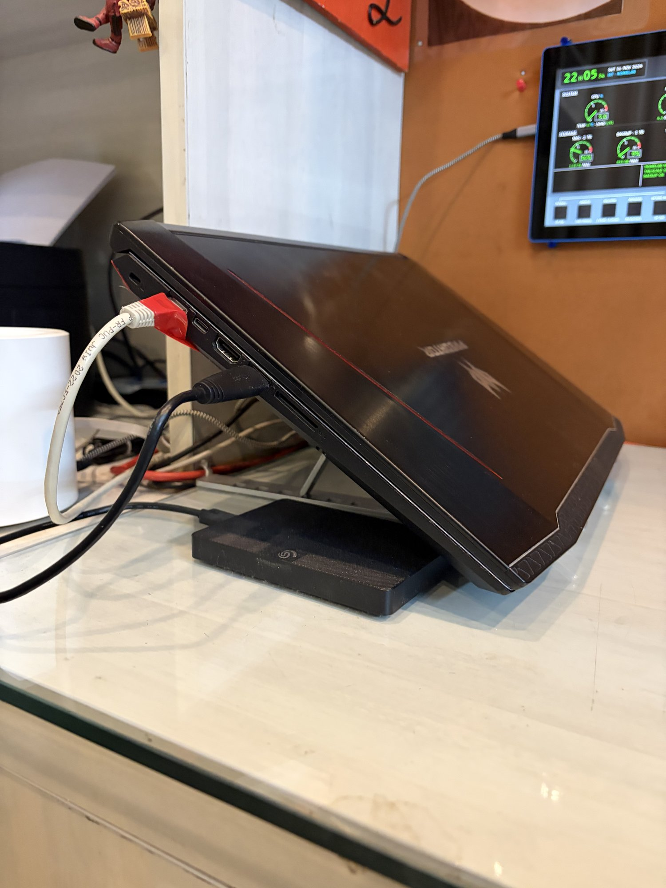
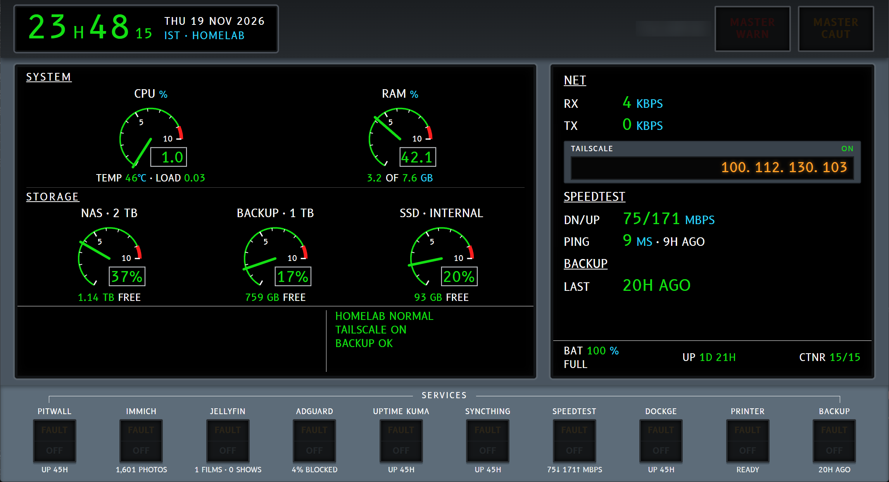
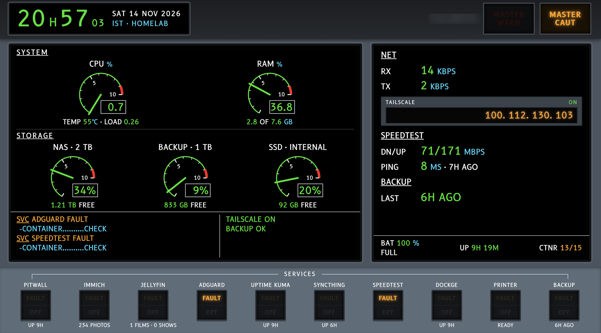
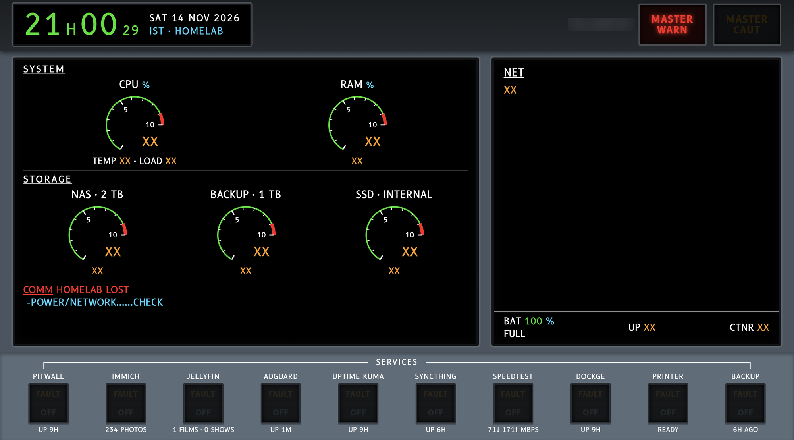

# my-homelab

An old gaming laptop with a dead GPU, turned into the family server at my parents' place.
I live in another city, so everything is managed remotely over Tailscale. This repo is its
configuration, and the server pushes it here by itself every night.



## Hardware

| | |
|---|---|
| **Server** | Acer Predator Helios 300: i5-8300H, 8 GB RAM, Ubuntu Server 26.04 LTS. Runs lid-closed; its battery doubles as a UPS. |
| **Dead GPU** | The Nvidia card failed, so a udev rule removes it from the PCI bus at boot and the laptop runs on the Intel iGPU (which Jellyfin uses for transcoding). |
| **Storage** | 128 GB SSD for the OS and Docker · 2 TB USB drive for media and photos · 1 TB internal drive just for backups |
| **Wall tablet** | A Lenovo tablet showing the status dashboard (below) |
| **Printer** | Epson L4160 on USB, shared to every device through CUPS |

<p>
  
  
</p>

## What runs on it

| Service | What it's for |
|---|---|
| [Immich](https://immich.app) | Photo backup for the whole family's phones |
| [Jellyfin](https://jellyfin.org) | Movies and shows, with iGPU transcoding |
| [AdGuard Home](https://adguard.com/adguard-home/overview.html) | Ad blocking and DNS for the home network |
| [Syncthing](https://syncthing.net) | File sync between my devices and the server |
| [Uptime Kuma](https://uptime.kuma.pet) · [Speedtest Tracker](https://github.com/alexjustesen/speedtest-tracker) | Monitoring and internet speed history |
| [Dockge](https://dockge.kuma.pet) | Web UI for the Docker Compose stacks |
| Samba · CUPS | Network drive and printer sharing |
| Pitwall | A live F1 timing app shared with friends. It runs on its own separate tailnet. |
| Homelab board | The dashboard: a small Python server with a JSON API |

Nothing is exposed to the internet. I reach everything over Tailscale (the server is also an exit node, and SSH goes
through Tailscale SSH), and family devices reach it over the home LAN.

## The dashboard

The wall tablet shows a status page styled after an airliner cockpit display. It shows CPU, RAM and temperature,
the three disks, network traffic, the last speed test, the last backup, and one indicator per service.
When something breaks, the matching light comes on and so does **MASTER CAUT** (amber) or **MASTER WARN** (red),
with a checklist-style message underneath.



| Two containers down: amber caution | Server unreachable: red warning |
|---|---|
|  |  |

There are four themes (`a320`, `md80`, `retro`, `classic`), and switching takes one line in a file. Open pages reload on their own.
The code is in [`opt/homelab-board/`](opt/homelab-board/).

## Backups

- **03:00**: the whole setup (`/opt`, system config, crontabs) is archived to the 2 TB drive.
- **03:30**: [restic](https://restic.net) takes versioned snapshots of everything irreplaceable (photos, synced files,
  videos that exist only here) onto the internal 1 TB drive. It keeps 14 daily, 8 weekly and 12 monthly snapshots,
  and every Sunday it prunes and verifies a sample of the data.
- **Every 5 minutes**: a [healthchecks.io](https://healthchecks.io) ping, sent only when both drives are mounted.
- **Not done yet**: an off-site copy. The old 500 GB drive is set aside for it.

Media that can be downloaded again and videos that already have a cloud copy are deliberately left out. Details are in [docs/backups.md](docs/backups.md).

## This repo

The folders mirror where each file lives on the server:

```
opt/        Docker Compose stacks (/opt/<name>) + the dashboard
etc/        fstab, Samba, CUPS, GRUB, systemd units, udev rule
usr/        /usr/local/bin scripts: backups, USB-drive recovery, console status screen
crontabs/   root and user crontabs
docs/       the long-form documentation
CLAUDE.md   operating notes for Claude Code, which I use to manage the box
sync.sh     refreshes this repo from the server's nightly archive
```

Every night at 04:15 the server runs `sync.sh --push`. It copies only an allowlist of config files out of the 03:00 archive,
turns `.env` files into `.env.example` with placeholder values, masks private details, refuses to continue if anything
looks like a secret, and commits as `Sync from homelab YYYY-MM-DD`.
No secrets, app data or backups are in this repo. See [docs/sync.md](docs/sync.md).

## More detail

- [docs/architecture.md](docs/architecture.md): network, the two tailnets, disks and folder layout, host tweaks
- [docs/services.md](docs/services.md): ports, per-service notes, the dashboard, the printer, scheduled jobs
- [docs/backups.md](docs/backups.md): how the backups work, and how to restore
- [docs/rebuild.md](docs/rebuild.md): rebuilding the server from scratch with this repo
- [docs/sync.md](docs/sync.md): how this repo stays current, and what is kept out of it
